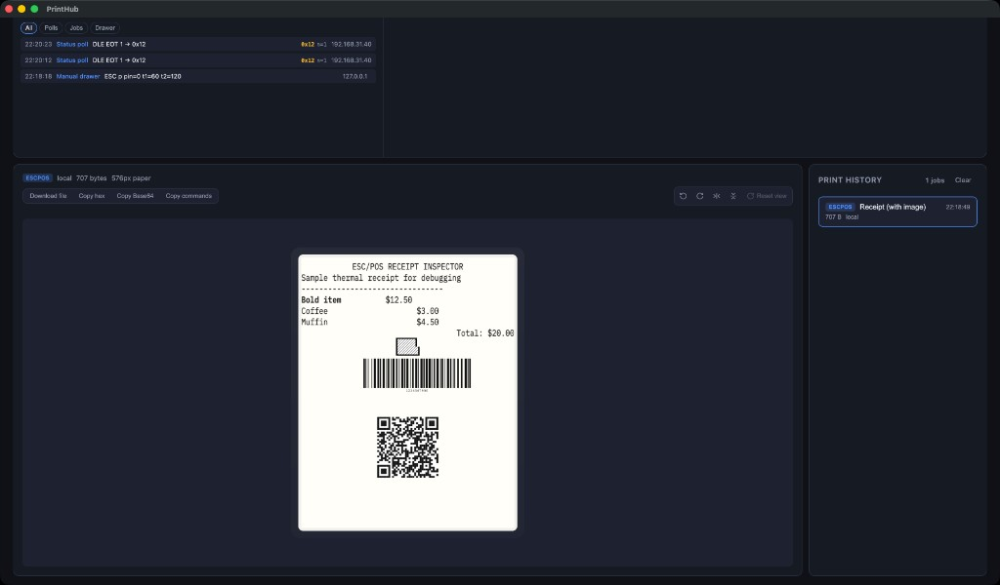
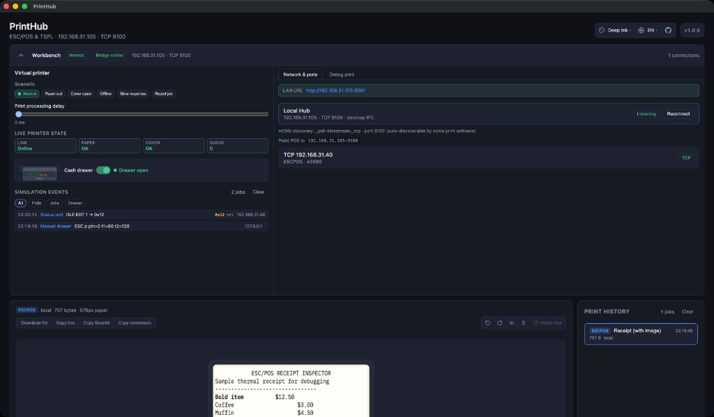
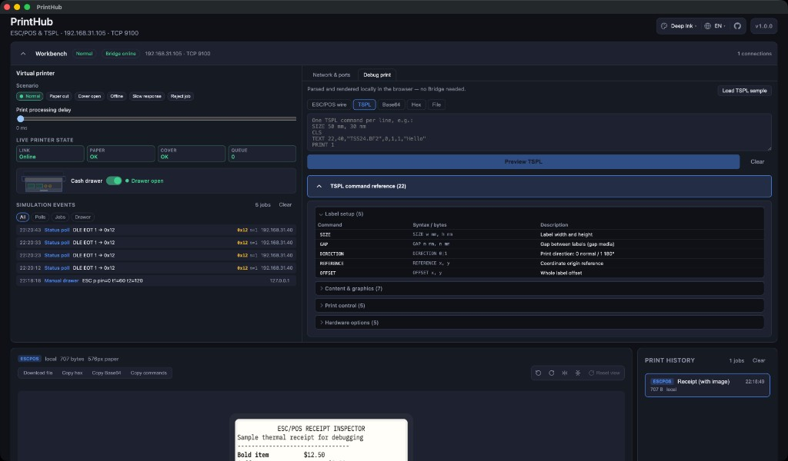
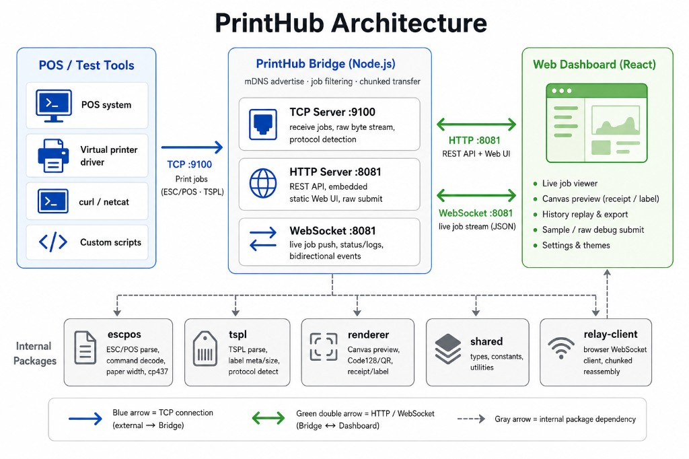

# PrintHub

> **中文：** [README.zh.md](./README.zh.md)

[](LICENSE)
[](https://github.com/JackieLeee/PrintHub/releases)
[](https://nodejs.org/)
[](https://pnpm.io/)

**Debug ESC/POS receipts and TSPL labels without a physical printer.** PrintHub is a virtual printer for POS and label developers: preview print output, inspect commands, and replay jobs in the browser.

**[Try the web demo](https://jackieleee.github.io/PrintHub/)** · **[Download the desktop app](https://github.com/JackieLeee/PrintHub/releases)** · [Run from source](#run-from-source)

On your first visit, the demo opens with a sample receipt. Choose **Try receipt** or **Try label** to explore the preview, then load your own File / Hex / Base64 payload in Debug print. Local previews work without Bridge; receiving raw TCP print jobs requires the desktop app (Bridge included) or a local Bridge.



## Features

| | |
|---|---|
| **Inspector** | Grouped command blocks (Setup / Preview / composite) linked to canvas highlight |
| **Export** | PNG & PDF (label-sized), Hex / Base64 / commands / raw payload |
| **Analyze** | `printhub-analyze` CLI — JSON `commands`, `blocks`, `summary` for agents & CI |
| **Preview** | ESC/POS & TSPL canvas rendering; Star dialect badge; last **50** jobs |
| **Debug** | Samples + File / Hex / Base64 — works **offline** without Bridge |
| **Workbench** | Virtual printer · Network & ports · Debug print · Printer sim · Command ref |
| **Desktop** | Electron + Bridge, tray, EN/中文, optional LAN HTTP |
| **Discovery** | mDNS `_pdl-datastream._tcp` on **9100** |

**With Bridge running:** TCP **9100** (print) · HTTP **8081** (Web UI + API; CLI always on, desktop optional)

**Added in v1.1.0:** Inspector ↔ preview linkage · PNG/PDF export · `@virt-printer/analyze` for agents · Star dialect detection · expanded command reference & fixture corpus.

## Download

[Download installers and release notes](https://github.com/JackieLeee/PrintHub/releases). The desktop app includes Bridge for receiving print jobs over your LAN.

| Platform | File |
|----------|------|
| macOS (Apple Silicon) | `*-mac-arm64.dmg` |
| macOS (Intel) | `*-mac-x64.dmg` |
| Windows x64 | `*-win-x64.exe` |

> **Unsigned builds.** macOS: right-click → **Open**. Windows: **More info → Run anyway**.

1. Install and launch PrintHub, then open its built-in workbench.
2. Point your POS or label application at **`<PrintHub host IP>:9100`**.
3. To open the workbench from another device, enable LAN HTTP in the tray menu and visit `http://<PrintHub host IP>:8081`.

## Run from source

**Node.js 20+ · pnpm 9.15.9** (the version pinned in `package.json`).

```bash
git clone https://github.com/JackieLeee/PrintHub.git
cd PrintHub
pnpm install
pnpm dev          # Builds the Web UI and starts Bridge
```

1. Keep the command running and open **http://localhost:8081** (LAN: `http://<host>:8081`).
2. Point your POS or label application at **`<host>:9100`**. Use `localhost` if it runs on the same computer.
3. Send a print job and inspect its preview and commands in the workbench.

```bash
# TCP smoke test (requires netcat with -N support)
printf '\x1b@\x1ba\x01Hello PrintHub\n\x1dV\x00' | nc -N localhost 9100
```

To run the Electron app from the same clone instead, stop the CLI Bridge first so port 9100 is free, then run:

```bash
pnpm dev:desktop
```

**Packaging:** `pnpm dist:desktop` (macOS) · `pnpm dist:desktop:win` (Windows)

| Workbench | TSPL label debugging |
|:---:|:---:|
|  |  |

## Architecture



`apps/desktop` · `apps/web` · `packages/bridge` · `packages/{escpos,tspl,renderer,analyze,fixtures}` · `packages/{shared,relay-client}`

**Analyze (CLI):** From the repository root, analyze a captured payload as JSON. Use an absolute path to your `.bin` or `.tspl` file:

```bash
pnpm --filter @virt-printer/analyze exec node --import tsx src/cli.ts /path/to/job.bin
```

---

MIT · [CONTRIBUTING](./CONTRIBUTING.md) · [SECURITY](./SECURITY.md)

<a href="https://www.star-history.com/?repos=JackieLeee%2FPrintHub&type=date&legend=bottom-right">
 <picture>
   <source media="(prefers-color-scheme: dark)" srcset="https://api.star-history.com/chart?repos=JackieLeee/PrintHub&type=date&theme=dark&legend=bottom-right&sealed_token=nZ7TJ03ductF3SiTo2_x9Ry8wmdRlWLIKmXdxoqRfHGkvFTL1NlWxsoL_mwD-dvCVfMZyzyZBzIM8Ihzq8OU20MkofoZvSxuyMsDOOtdZ4QVigSvLemN2CREu9Vshu8wZoD0fdcGEmLEiHpFYXfkdgGvjq8Zi8n1CIzMHumwS2FRSd_6JyewdE8DLc-K" />
   <source media="(prefers-color-scheme: light)" srcset="https://api.star-history.com/chart?repos=JackieLeee/PrintHub&type=date&legend=bottom-right&sealed_token=nZ7TJ03ductF3SiTo2_x9Ry8wmdRlWLIKmXdxoqRfHGkvFTL1NlWxsoL_mwD-dvCVfMZyzyZBzIM8Ihzq8OU20MkofoZvSxuyMsDOOtdZ4QVigSvLemN2CREu9Vshu8wZoD0fdcGEmLEiHpFYXfkdgGvjq8Zi8n1CIzMHumwS2FRSd_6JyewdE8DLc-K" />
   
 </picture>
</a>
