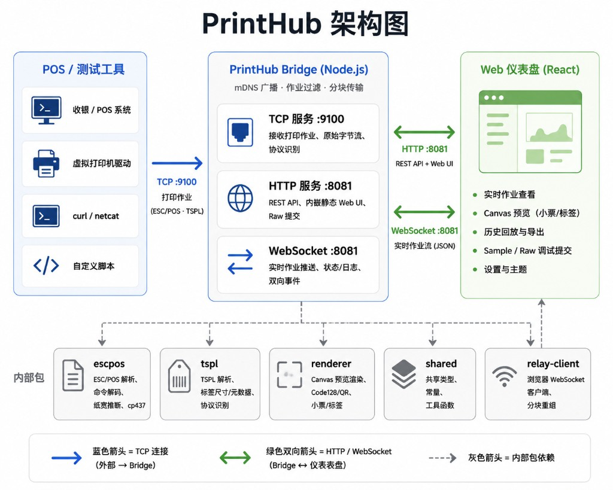

# PrintHub

> **English:** [README.md](./README.md)

[](LICENSE)
[](https://github.com/JackieLeee/PrintHub/releases)
[](https://nodejs.org/)
[](https://pnpm.io/)

**无需实体打印机，即可调试 ESC/POS 小票与 TSPL 标签。** PrintHub 是面向 POS 与标签应用开发者的虚拟打印机，支持在浏览器中预览打印效果、检查指令和回放任务。

**[体验在线演示](https://jackieleee.github.io/PrintHub/)** · **[下载桌面版](https://github.com/JackieLeee/PrintHub/releases)** · [从源码运行](#从源码运行)

首次打开演示时会显示示例小票，可一键切换小票或标签，再通过「调试打印」加载自己的 File / Hex / Base64 数据。本地预览无需 Bridge；接收 TCP 打印任务需运行桌面版（已集成 Bridge）或本地 Bridge。


## 功能

| | |
|---|---|
| **检查器** | 指令块分组（Setup / Preview / 复合），点击高亮预览区域 |
| **导出** | PNG / PDF（标签物理尺寸）、Hex / Base64 / 指令 / 原始文件 |
| **Analyze** | `printhub-analyze` CLI — JSON 结构化输出，供 Agent 与 CI 使用 |
| **预览** | ESC/POS & TSPL Canvas；Star 方言徽章；最近 **50** 条任务 |
| **调试** | Sample + File / Hex / Base64 — **可离线**，无需 Bridge |
| **工作台** | 虚拟打印机 · 网络与端口 · 调试打印 · 打印机模拟 · 命令手册 |
| **桌面端** | Electron 集成 Bridge、托盘、中/EN、可选局域网 HTTP |
| **发现** | mDNS `_pdl-datastream._tcp` · 端口 **9100** |

**Bridge 运行时：** TCP **9100**（打印）· HTTP **8081**（Web 控制台与 API；CLI 常开，桌面端可选）

**v1.1.0 新增：** Inspector 与预览联动 · PNG/PDF 导出 · `@virt-printer/analyze` Agent API · Star 方言检测 · 命令手册与 fixtures 回归库。

## 下载

[下载安装包与查看版本说明](https://github.com/JackieLeee/PrintHub/releases)。桌面版已集成 Bridge，可接收局域网内的打印任务。

| 平台 | 文件 |
|------|------|
| macOS（Apple 芯片） | `*-mac-arm64.dmg` |
| macOS（Intel） | `*-mac-x64.dmg` |
| Windows x64 | `*-win-x64.exe` |

> **未签名。** macOS：**右键 → 打开**。Windows：**更多信息 → 仍要运行**。

1. 安装并启动 PrintHub，打开内置工作台。
2. 将 POS 或标签应用的打印地址设为 **`<PrintHub 主机 IP>:9100`**。
3. 如需从其他设备打开工作台，在托盘菜单中开启局域网 HTTP，再访问 `http://<PrintHub 主机 IP>:8081`。

## 从源码运行

**Node.js 20+ · pnpm 9.15.9**（`package.json` 中指定的版本）。

```bash
git clone https://github.com/JackieLeee/PrintHub.git
cd PrintHub
pnpm install
pnpm dev          # 构建 Web 控制台并启动 Bridge
```

1. 保持命令运行，打开 **http://localhost:8081**（局域网：`http://<主机 IP>:8081`）。
2. 将 POS 或标签应用的打印地址设为 **`<主机 IP>:9100`**；如果应用与 PrintHub 在同一台电脑上，可使用 `localhost`。
3. 发送打印任务，在工作台中查看预览与指令。

```bash
# TCP 快速测试（需要支持 -N 参数的 netcat）
printf '\x1b@\x1ba\x01Hello PrintHub\n\x1dV\x00' | nc -N localhost 9100
```

如需从同一份源码启动 Electron 桌面端，请先停止 CLI Bridge，释放 9100 端口，再运行：

```bash
pnpm dev:desktop
```

**打包：** `pnpm dist:desktop`（macOS）· `pnpm dist:desktop:win`（Windows）

| 工作台 | TSPL 标签调试 |
|:---:|:---:|
|  |  |

## 架构



`apps/desktop` · `apps/web` · `packages/bridge` · `packages/{escpos,tspl,renderer,analyze,fixtures}` · `packages/{shared,relay-client}`

**Analyze（CLI）：** 在仓库根目录中，将捕获的打印数据解析为 JSON。请使用 `.bin` 或 `.tspl` 文件的绝对路径：

```bash
pnpm --filter @virt-printer/analyze exec node --import tsx src/cli.ts /path/to/job.bin
```

---

MIT · [CONTRIBUTING](./CONTRIBUTING.md) · [SECURITY](./SECURITY.md)

<a href="https://www.star-history.com/?repos=JackieLeee%2FPrintHub&type=date&legend=bottom-right">
 <picture>
   <source media="(prefers-color-scheme: dark)" srcset="https://api.star-history.com/chart?repos=JackieLeee/PrintHub&type=date&theme=dark&legend=bottom-right&sealed_token=nZ7TJ03ductF3SiTo2_x9Ry8wmdRlWLIKmXdxoqRfHGkvFTL1NlWxsoL_mwD-dvCVfMZyzyZBzIM8Ihzq8OU20MkofoZvSxuyMsDOOtdZ4QVigSvLemN2CREu9Vshu8wZoD0fdcGEmLEiHpFYXfkdgGvjq8Zi8n1CIzMHumwS2FRSd_6JyewdE8DLc-K" />
   <source media="(prefers-color-scheme: light)" srcset="https://api.star-history.com/chart?repos=JackieLeee/PrintHub&type=date&legend=bottom-right&sealed_token=nZ7TJ03ductF3SiTo2_x9Ry8wmdRlWLIKmXdxoqRfHGkvFTL1NlWxsoL_mwD-dvCVfMZyzyZBzIM8Ihzq8OU20MkofoZvSxuyMsDOOtdZ4QVigSvLemN2CREu9Vshu8wZoD0fdcGEmLEiHpFYXfkdgGvjq8Zi8n1CIzMHumwS2FRSd_6JyewdE8DLc-K" />
   
 </picture>
</a>
